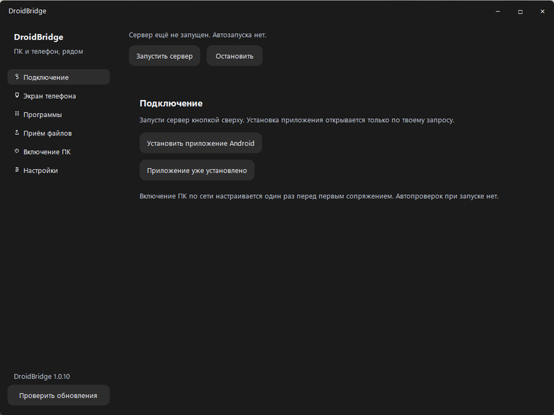

# DroidBridge

Телефон вместо пульта для компьютера. Или наоборот — экран телефона на ПК и управление мышью. Всё работает в одной домашней сети, без аккаунтов и облака.

**[Скачать для Windows и Android](https://github.com/alexfduch231-prog/DroidBridge/releases/latest)** · [English](#english)

## Что можно делать

- Смотреть экран ПК на телефоне, нажимать, прокручивать и печатать своей обычной клавиатурой Android.
- Вывести телефон на монитор и пользоваться им мышью.
- Перекидывать файлы **в обе стороны**, выбирать папку и продолжать передачу после обрыва. До 50 ГиБ на файл, без перезаписи одноимённых файлов.
- Запускать свои программы, управлять музыкой, блокировать, перезагружать и выключать компьютер.
- Будить ПК по сети, если он поддерживает Wake-on-LAN.

## Как начать

1. Установи приложение на компьютер и телефон, подключи их к одной сети.
2. На ПК нажми **«Запустить сервер»**, затем открой **«Подключение»**. При первом подключении пройди настройку включения ПК по сети — приложение подскажет, что проверить.
3. Создай QR подключения. На телефоне открой настройки и нажми **«Сканировать QR»**.
4. Сравни код на двух экранах и подтверди подключение на обоих устройствах.

После этого выбирай, что нужно: показать экран, отправить файл или запустить программу. Для трансляции телефона нажми **«Трансляция на ПК»** на Android и разреши показ экрана. Управление телефоном мышью включается отдельно через специальные возможности Android.

Для отправки файла **на телефон** выбери его на ПК в разделе **«Приём файлов»**. Затем на телефоне открой **«Файлы» → «Получить с ПК»**, выбери папку и забери файл из очереди. Весь диск при этом не расшаривается.

Что-то не подключается? **[Здесь инструкция и помощь](docs/GETTING_STARTED.md)**.

## Перед установкой

Нужны **Windows 10/11 x64** и **Android 5+**. Для управления телефоном жестами — Android 7+. Показ экрана ПК пока требует видеокарту **NVIDIA с NVENC**.

Пользуйся в доверенной домашней сети: команды, видео и файлы пока передаются без шифрования. Не открывай порты приложения в интернет. Пробуждение ПК зависит от его настроек и железа.

Во время передачи файлов оставляй экран передачи открытым. Для докачки на ПК нужна папка на NTFS; для получения на телефоне — свободное место под временную копию и готовый файл. [Подробности о передаче файлов](docs/GETTING_STARTED.md).

## Скриншоты

[Остальные экраны](docs/SCREENSHOTS.md)

## О проекте

Сделал с помощью ИИ для себя, потом решил поделиться — вдруг ещё кому пригодится.

Нашёл баг или хочешь что-то добавить — [пиши в Issues](https://github.com/alexfduch231-prog/DroidBridge/issues). Хочешь помочь кодом — [как участвовать](CONTRIBUTING.md) и [как собрать проект](docs/DEVELOPMENT.md).

[Что нового](CHANGELOG.md) · [Безопасность](SECURITY.md) · [Лицензия MIT](LICENSE)

---

# English

Use your phone as a remote for your PC — or put your phone screen on the PC and control it with a mouse. Both devices stay on your home network. No accounts or cloud service.

**[Download for Windows and Android](https://github.com/alexfduch231-prog/DroidBridge/releases/latest)**

## What you can do

- View your PC screen on your phone, click, scroll and type with your usual Android keyboard.
- View and control your phone from your PC.
- Send files **both ways**, choose where to save them and resume interrupted transfers. Up to 50 GiB per file, without overwriting existing files.
- Launch your programs, control music, lock, restart and shut down your PC.
- Wake the PC over the network if it supports Wake-on-LAN.

## Getting started

1. Install the app on your PC and phone and connect both to the same network.
2. On the PC, click **Start server**, then open **Connection**. Complete the first-time network-wake setup; the app walks you through what to check.
3. Create a pairing QR. On your phone, open Settings and tap **Scan QR**.
4. Compare the code on both screens and approve the connection on both devices.

Then choose what you want to do: share a screen, send a file or launch a program. To show your phone on the PC, tap **Cast phone to PC** on Android and approve screen sharing. Mouse control needs a separate Android Accessibility permission.

To send a file **to your phone**, select it in **Received files** on the PC. On Android, open **Files → Receive from PC**, choose a folder and select the queued file. This doesn't share your whole drive.

Need a hand? **[Setup guide and troubleshooting](docs/GETTING_STARTED.md#english)**. The Windows sidebar currently uses Russian labels.

## Before installing

Requires **Windows 10/11 x64** and **Android 5+**. Phone-control gestures need Android 7+. PC screen streaming currently requires an **NVIDIA GPU with NVENC**.

Use a trusted home network: commands, video and files aren't encrypted yet. Don't expose the app's ports to the internet. Waking the PC depends on its hardware and settings.

Keep the transfer screen open while sending or receiving. Resumable uploads to the PC need an NTFS destination. Receiving on Android needs room for both the temporary copy and the saved file. [File transfer details](docs/GETTING_STARTED.md#english).

## Screenshots

[Take a look at the interface](docs/SCREENSHOTS.md)

## About

Built with AI for my own setup, then shared in case someone else finds it useful.

Found a bug or have an idea? [Open an Issue](https://github.com/alexfduch231-prog/DroidBridge/issues). Want to help with the code? See [contributing](CONTRIBUTING.md) and the [build guide](docs/DEVELOPMENT.md).

[What's new](CHANGELOG.md) · [Security](SECURITY.md) · [MIT license](LICENSE)
