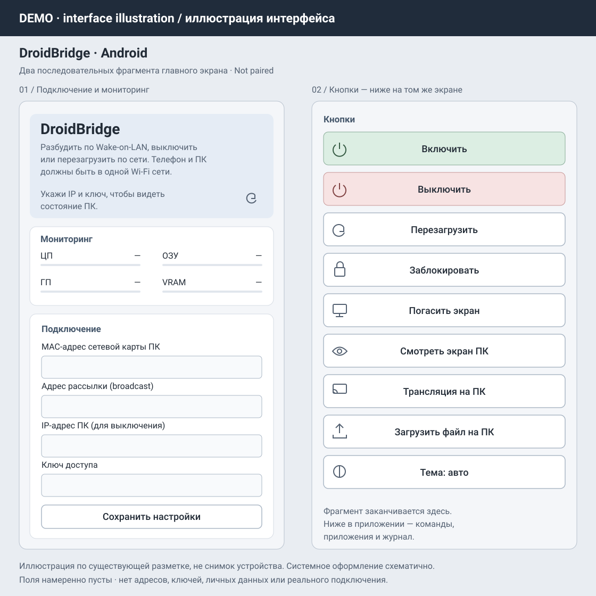
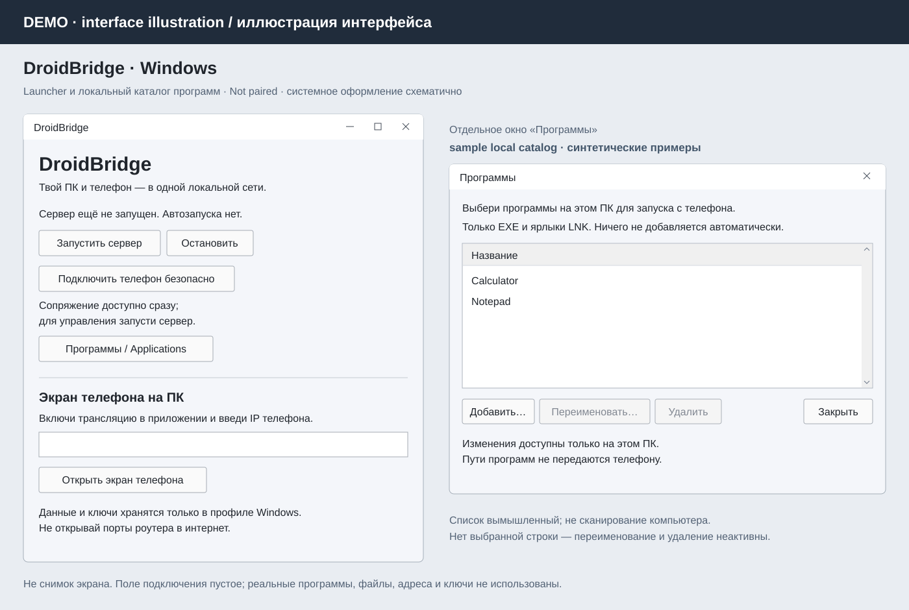

# DroidBridge

Телефон как пульт для домашнего Windows-ПК — и экран телефона на компьютере. Работает в общей локальной сети, без облачного сервиса.

**[Windows и Android — скачать](https://github.com/alexfduch231-prog/DroidBridge/releases/latest)** · [English](#english)

Здесь описывается готовящийся Windows-интерфейс **1.0.6**: одно основное окно с разделами слева. Пока выпуск не опубликован, ссылка выше ведёт на последнюю доступную версию; её интерфейс может отличаться. Готовится Android **1.16** (сборка **26**): вместе с Windows **1.0.6** он показывает значки программ из настроенных на ПК EXE и ярлыков LNK. Если значок получить не удалось или одна из сторон старой версии, останется обычный значок программы. Android **1.15** остаётся совместимым для прежних функций. Проверка новых сценариев на реальном телефоне пока не подтверждена.

## Что можно делать

- Смотреть экран ПК с телефона, нажимать, прокручивать и вводить текст.
- Смотреть экран Android на ПК; отдельно разрешить управление телефоном. Звук доступен на Android 10+ там, где приложение разрешает захват.
- Отправлять файлы с телефона в выбранную папку на ПК.
- Блокировать, выключать и перезагружать ПК, управлять музыкой, запускать выбранные тобой программы. Wake-on-LAN может разбудить ПК, если настроен на самом компьютере.

## Начать

1. Скачай установщик Windows и Android APK со страницы релиза. Архивы **Source code** для установки не нужны. В готовящемся интерфейсе 1.0.6 QR скачивания APK находится в разделе **«Подключение» → «Установить на телефон»**. Если приложение уже есть, выбери **«Уже установлено → подключить к ПК»**.
2. Установи приложения и подключи устройства к одной доверенной домашней сети. Нужны Windows 10/11 x64 и Android 5+; жесты управления телефоном — Android 7+.
3. На ПК нажми **«Запустить сервер»** вверху окна. В разделе **«Подключение»** перейди к сопряжению, выбери домашний сетевой адаптер и нажми **«Создать новый QR»**. Пока подключаешь телефон, оставайся в этом разделе.
4. Открой QR телефоном или вставь скопированную ссылку в **«Добавить ПК»**. Сравни код на двух устройствах, нажми **«Разрешить»** на ПК и **«Сохранить ПК»** на телефоне.
5. Попробуй **«Заблокировать»** или **«Смотреть экран ПК»** на телефоне. Для обратной трансляции используй раздел Windows **«Экран телефона»**. Программы и папка приёма файлов настраиваются в своих разделах, медиакомплект — в **«Настройки»**.

Обычный Windows-установщик содержит **FFmpeg и ffplay** и выбирает их автоматически. Отдельно скачивать их, менять PATH или устанавливать Python не нужно. Ручной выбор другой сборки нужен только при восстановлении или осознанной замене инструментов.

**[Подробная инструкция и помощь с подключением](docs/GETTING_STARTED.md)** · [Изменения и статус 1.0.6](CHANGELOG.md)

## Одно основное окно

В готовящемся 1.0.6 разделы **«Подключение»**, **«Экран телефона»**, **«Программы»**, **«Приём файлов»** и **«Настройки»** открываются внутри одного окна. Скачивание Android-приложения и сопряжение находятся в подключении; просмотр телефона — в своём разделе. Для просмотра телефона главное окно DroidBridge должно быть открыто: запрос с телефона направляется в него, а не запускает отдельное окно просмотра. Один сервер без основного окна может обслуживать команды, но не встроенный просмотр телефона. Системные запросы разрешений, выбор файлов и подтверждения по-прежнему могут открывать диалоги.

При уходе со страницы сопряжения временный QR перестаёт действовать: вернись в **«Подключение»** и создай новый. При уходе с просмотра телефона подключение просмотра закрывается. Сервер запускается только по твоей команде; его статус не доказывает доступность ПК с телефона.

## Обновления

Начиная с 1.0.4 Windows- и Android-приложение проверяют обновления при запуске и предлагают **«Позже» / «Обновить»**. Первую версию с этой функцией нужно установить вручную. Windows скачивает и проверяет установщик перед закрытием собственных компонентов и повторно открывает приложение только после успешной установки. На Android обязательно системное подтверждение установки APK; повторное открытие или уведомление зависит от ограничений системы. [Подробности](docs/GETTING_STARTED.md#обновления).

## Важно знать

**Только доверенная локальная сеть.** Сопряжение защищено TLS, но основной транспорт команд, видео и файлов **не зашифрован**. Не открывай порты роутера в Интернет. Подключения через облако нет.

Защищённые экраны Android и UAC Windows не обходятся. Передача файлов — до 50 ГиБ. Для паузы и продолжения исходный файл должен остаться доступным и неизменным. Нужна папка приёма на NTFS или другом диске с поддержкой жёстких ссылок; FAT/exFAT не поддерживаются. Незавершённые передачи хранятся до 7 дней и не считаются готовыми файлами. Подготовка большого файла может занять время; во время подготовки и передачи держи Android-приложение на экране. Проверка продолжения на реальном телефоне и реальная передача 50 ГиБ пока не подтверждены. Совместимость с каждым устройством не гарантируется. Текущий режим H.264 экрана ПК использует NVIDIA NVENC: нужна поддерживаемая видеокарта NVIDIA и подходящий драйвер. Наличие FFmpeg само по себе не гарантирует работу этого режима на любом Windows-ПК.

## Как выглядит

Ниже **иллюстрации прежнего интерфейса, не скриншоты**. Они не показывают точный вид готовящегося единого окна 1.0.6.

  
  

## О проекте

DroidBridge сделан с помощью ИИ изначально для себя — чтобы управлять домашним компьютером с телефона. Это экспериментальный личный проект, которым автор делится с другими. ИИ участвовал в написании кода; это не обещание безошибочной работы или профессиональной поддержки. Пользуйся только на своих устройствах или с разрешения их владельца.

Нашёл ошибку или есть идея — [создай Issue](https://github.com/alexfduch231-prog/DroidBridge/issues). Для разработки: [инструкция](docs/DEVELOPMENT.md), [участие](CONTRIBUTING.md), [безопасность](SECURITY.md). Оригинальный код — [MIT](LICENSE).

---

# English

Use your phone as a remote for your Windows PC, or view your phone on the computer. DroidBridge works on the same local network, without a cloud service.

**[Windows and Android — download](https://github.com/alexfduch231-prog/DroidBridge/releases/latest)**

This page describes the upcoming Windows **1.0.6** interface: one main window with sidebar sections. Until it is published, the link above opens the latest available release, whose interface may differ. Upcoming Android **1.16** (build **26**), together with Windows **1.0.6**, shows program icons from the EXE files and LNK shortcuts configured on the PC. If an icon cannot be obtained or either side is older, a generic program icon remains. Android **1.15** remains compatible with existing features. Verification of new scenarios on a real phone is not yet confirmed.

## What you can do

- View and control the PC screen from your phone: click, scroll and enter text.
- View Android on your PC, with optional phone control. Audio requires Android 10+ and an app that allows playback capture.
- Send files from your phone to a folder you choose on the PC.
- Lock, shut down or restart the PC, control media and launch programs you select. Wake-on-LAN can wake the PC if enabled in its hardware settings.

## Get started

1. Download the Windows installer and Android APK from the release page. You do not need the **Source code** archives. In the upcoming 1.0.6 interface, the APK download QR is under **«Подключение» → «Установить на телефон»** (Connection → Install on phone). If already installed, choose **«Уже установлено → подключить к ПК»** (Already installed → connect to PC).
2. Install both apps and connect them to the same trusted home network. Requires Windows 10/11 x64 and Android 5+; phone-control gestures require Android 7+.
3. Click **«Запустить сервер»** (Start server) at the top of the Windows window. Open pairing in **«Подключение»** (Connection), select your home network adapter and choose **Create new QR**. Stay in this section while pairing.
4. Open the QR link on Android, or paste the copied link into **Add PC**. Compare the code on both devices, click **Allow** on the PC, then **Save PC** on the phone.
5. Try **Lock** or **View PC screen** on Android. For phone-to-PC mirroring, use **«Экран телефона»** (Phone screen) on Windows. Programs and received-file destinations have their own sections; media tools are under **«Настройки»** (Settings).

The standard Windows installer **includes FFmpeg and ffplay and selects them automatically**. No separate download, PATH editing or Python installation is needed. Manual selection is for recovery or a deliberate tool replacement.

**[Full setup guide and troubleshooting](docs/GETTING_STARTED.md#english)** · [Changes and 1.0.6 status](CHANGELOG.md)

## One main window

Upcoming 1.0.6 has **«Подключение»** (Connection), **«Экран телефона»** (Phone screen), **«Программы»** (Applications), **«Приём файлов»** (Received files) and **«Настройки»** (Settings) inside one main window. Android download and pairing belong to Connection; phone viewing has its own section. Keep the DroidBridge main window open for phone viewing: the phone's request is handed to it instead of launching a separate viewer. A server running alone can handle commands, but not embedded phone viewing. System permission prompts, file pickers and confirmations can still open dialogs. The sidebar currently uses Russian labels.

Leaving pairing invalidates its temporary QR: return to Connection and create a new one. Leaving phone viewing closes the viewer connection. The server starts only when you request it; its status does not establish network reachability.

## Updates

Since 1.0.4, Windows and Android check for updates at startup and offer **Later / Update**. Install the first updater-capable version manually. Windows downloads and verifies the installer before closing its own components and reopens the app only after successful installation. Android requires system APK-installation approval; reopening or a notification depends on system restrictions. [Details](docs/GETTING_STARTED.md#updates).

## Limitations

**Trusted LAN only.** TLS protects pairing, but the main command, video and file transport is **not encrypted**. Do not forward router ports to the Internet. There is no cloud connection.

Android protected screens and Windows UAC restrictions are not bypassed. Uploads are limited to 50 GiB. For pause and resume, the source file must remain accessible and unchanged. The destination must use NTFS or another hard-link-capable disk; FAT/exFAT is unsupported. Incomplete transfers are kept for up to 7 days and are not finished files. Large-file preparation may take time; keep Android in the foreground during preparation and transfer. Real-phone resume verification and an actual 50 GiB transfer are not yet confirmed. Compatibility with every device is not guaranteed. Current PC-screen H.264 encoding uses NVIDIA NVENC and requires a supported NVIDIA GPU and driver; bundling FFmpeg does not make this mode work on every Windows PC. The images above are **illustrations of an earlier interface, not 1.0.6 screenshots**.

## About

DroidBridge was built with AI, originally for the author's own home setup, and is shared as an experimental personal project. AI helped write the code; that is not a promise of bug-free operation or professional support. Use it only on your own devices or with their owner's permission.

Bugs and ideas: [Issues](https://github.com/alexfduch231-prog/DroidBridge/issues). For developers: [development guide](docs/DEVELOPMENT.md), [contributing](CONTRIBUTING.md), [security](SECURITY.md). Original code: [MIT](LICENSE).
