# PConDistance: что где находится

[На главную](../README.md) · [Первое подключение](GETTING_STARTED.md) · [English](#english)

Здесь — настоящие экраны приложения на пустом профиле. Подписи объясняют, что нажать и что должно произойти дальше. Локальные пути в двух снимках закрыты сплошными полосами. Состояние без подключённого телефона не показывает работающую трансляцию. Системные окна установки, разрешений Android и UAC могут отличаться на твоём устройстве.

## До переименования / Before the rename — Windows 1.0.10

### Подключение / Connection

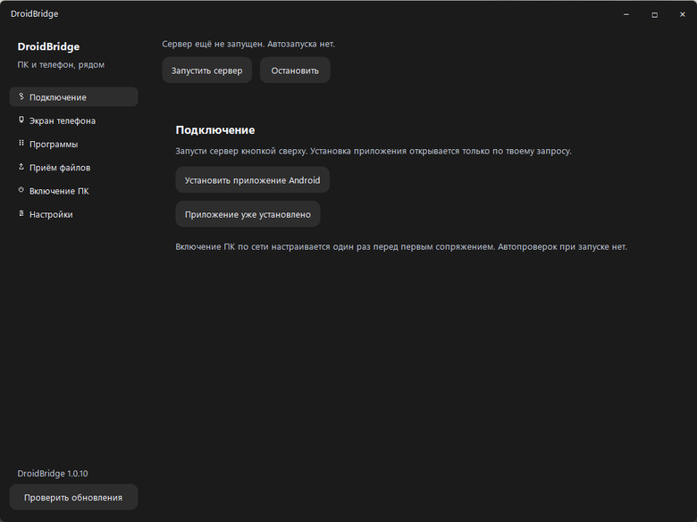

Запусти сервер и подключи телефон. / Start the server and pair your phone.

### Программы / Applications

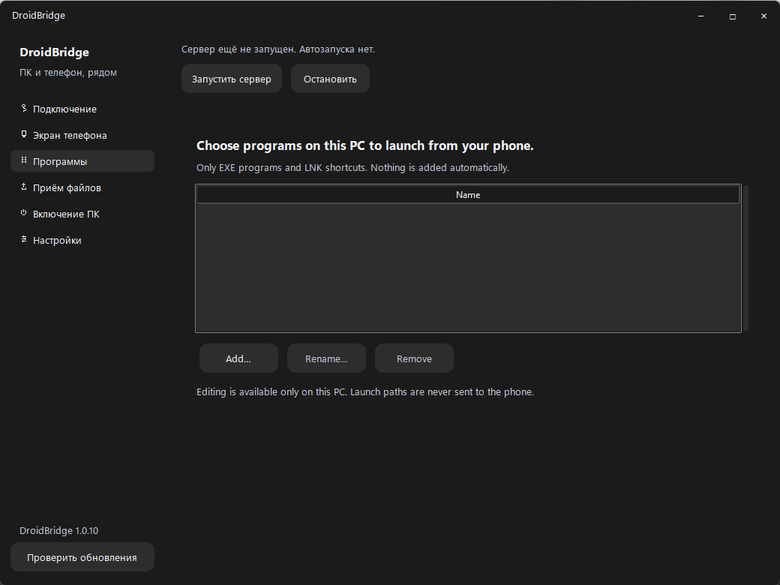

Здесь добавляются свои программы; на снимке список пуст. / Add your own programs here; this list is empty.

### Файлы в обе стороны / Bidirectional files

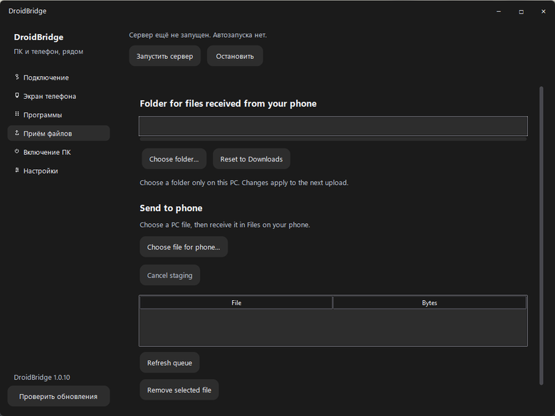

Сверху выбирается папка для файлов с телефона. Ниже — отправка выбранных файлов на телефон и очередь. Локальный путь закрыт. / Choose the PC destination at the top; queue files for your phone below. The local path is masked.

### Настройки / Settings

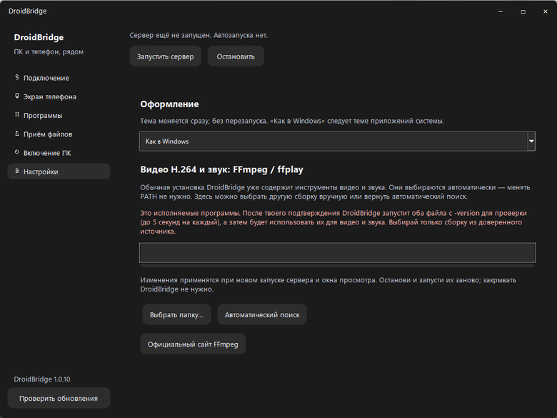

Выбор оформления и инструментов видео и звука. Локальный путь закрыт. / Appearance and video/audio tool selection. The local path is masked.

## Остальные экраны — предыдущие версии / Other screens — earlier versions

## Windows: подключение

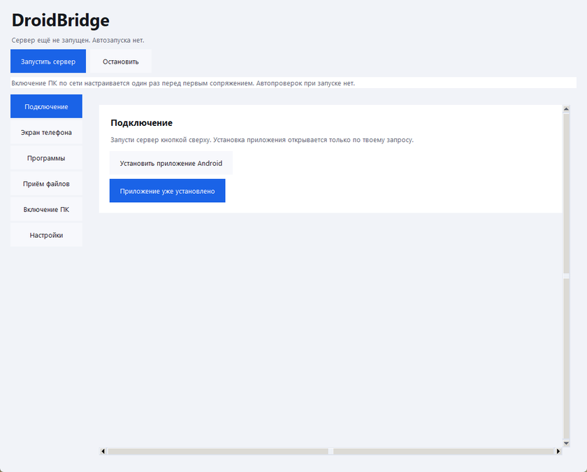

Запусти сервер, затем выбери установку Android или «Приложение уже установлено». Перед новым сопряжением приложение проведёт через настройку включения ПК по сети.

## Установка приложения на телефон

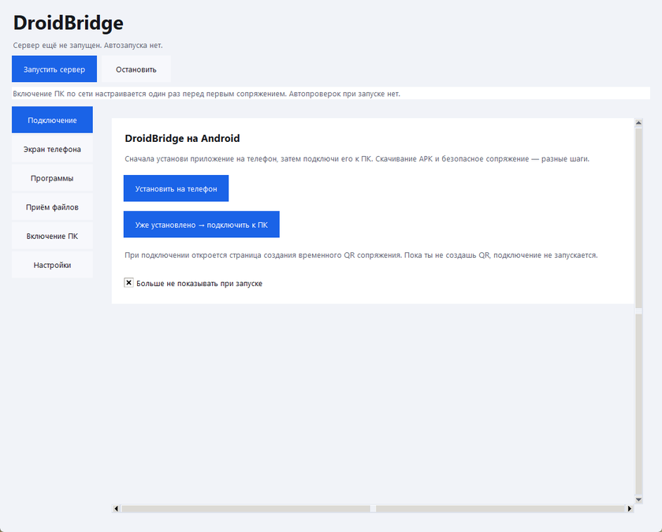

Если приложение уже есть, скачивание можно пропустить. Кнопка установки открывает следующий экран.

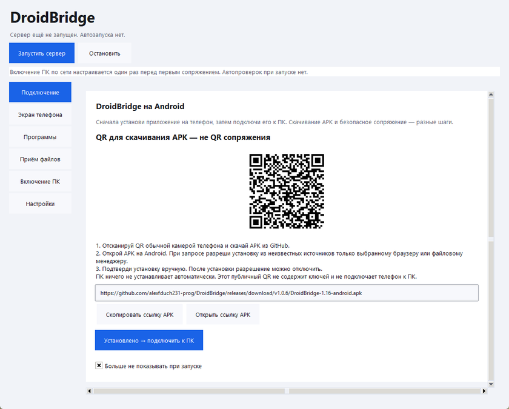

Этот QR ведёт на публичный APK в GitHub, а не подключает телефон к компьютеру. Скачай файл, подтверди установку на Android и нажми «Установлено → подключить к ПК».

## Обязательная первая настройка

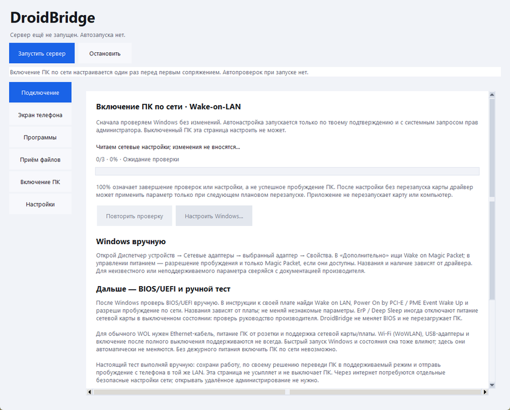

Перед первым сопряжением откроется проверка включения ПК по сети. Здесь показана верхняя часть страницы в ожидании проверки; галочки подтверждения находятся ниже. Снимок не показывает успешную настройку или пробуждение.

## Сопряжение телефона

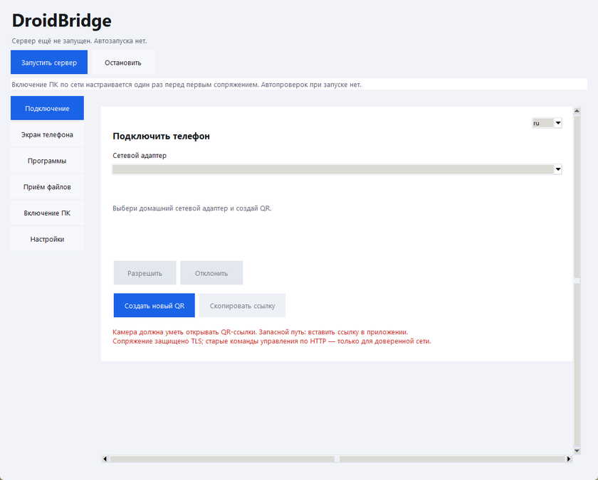

После настройки выбери домашний сетевой адаптер и создай QR. На этом снимке список адаптеров намеренно пуст, временное соединение не запущено. QR сопряжения на публичных снимках нет — он предназначен только для твоего телефона.

## Экран телефона

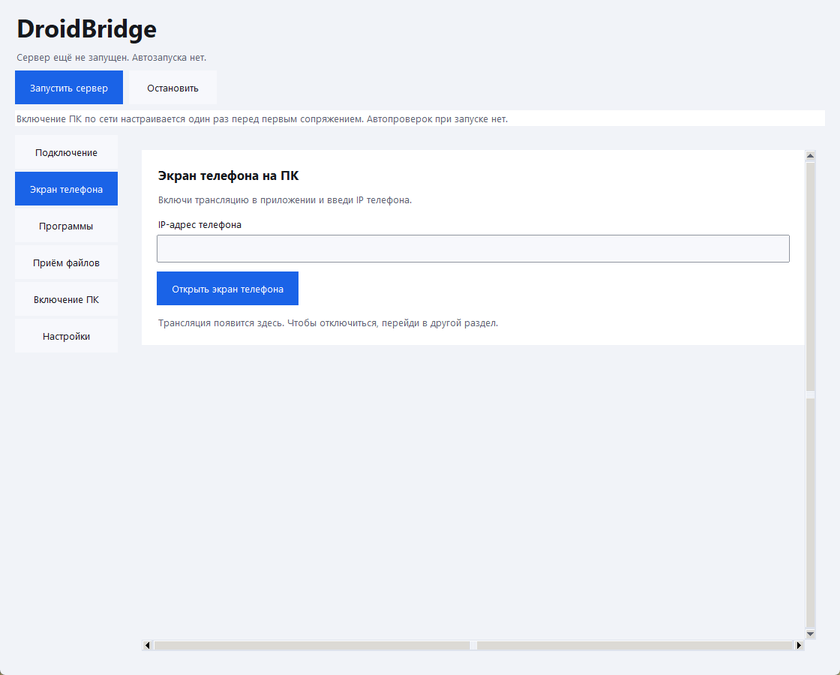

Это чистое состояние до подключения: IP не введён, поэтому трансляция не изображается. После сопряжения и запуска просмотра видео появится в этой же области.

## Приём файлов

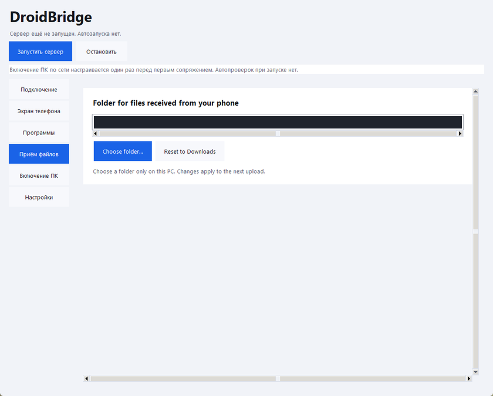

Выбери папку на ПК или верни «Загрузки». Путь в публичном снимке скрыт; новая папка используется для следующих передач.

## Программы

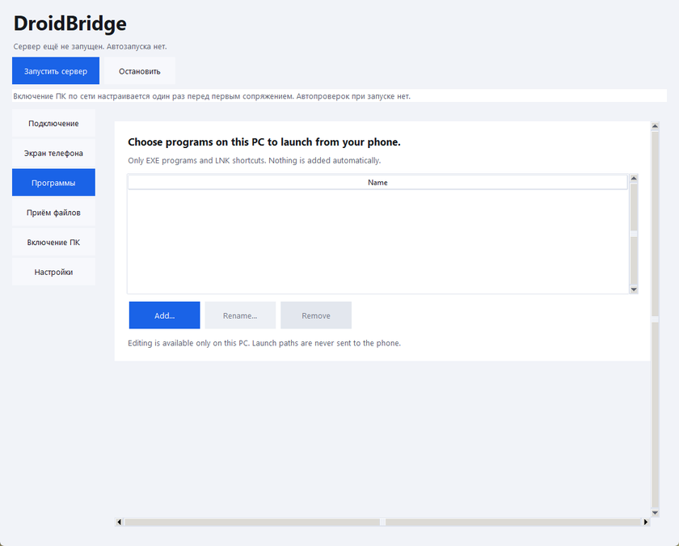

«Добавить…» / “Add…” позволяет выбрать EXE или ярлык LNK на компьютере. Затем программа появляется среди кнопок на телефоне. На снимке список пуст.

## Видео и звук

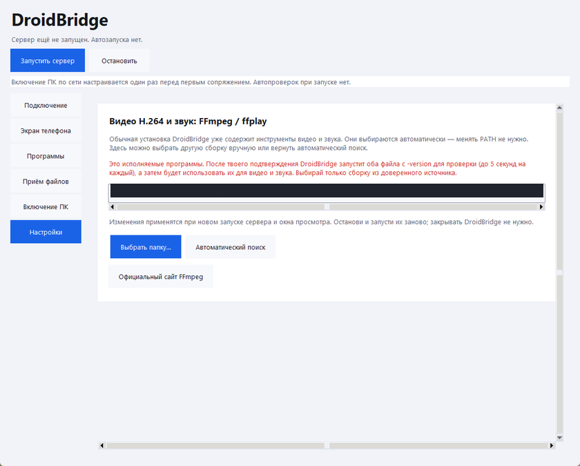

Обычная установка содержит FFmpeg и ffplay. Здесь можно выбрать локальную папку с инструментами или запустить безопасный поиск; новые настройки применяются после перезапуска сервера и просмотра.

## Включение ПК по сети

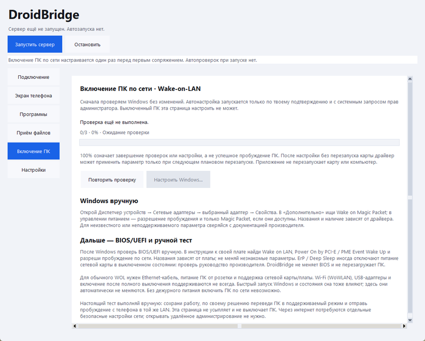

Страница объясняет проверку Windows и ручные настройки BIOS/UEFI. Здесь показано состояние до проверки. 100% означает завершение действий, а не доказательство, что выключенный ПК проснётся.

## Телефон: боковое меню

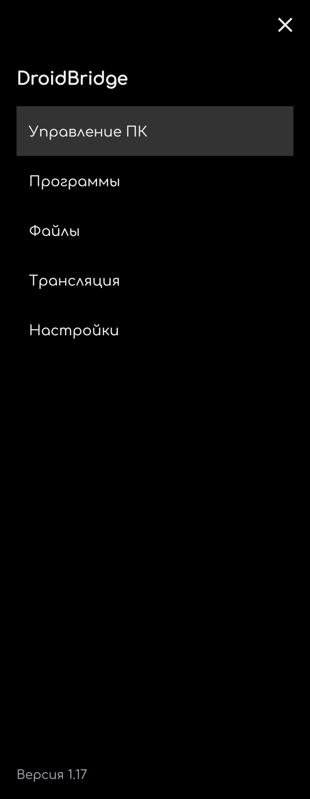

В меню собраны управление ПК, программы, файлы, трансляция и настройки. Крестик справа закрывает меню; номер версии находится внизу. Это экран Android 1.17 с системным шрифтом устройства.

## Телефон: управление ПК

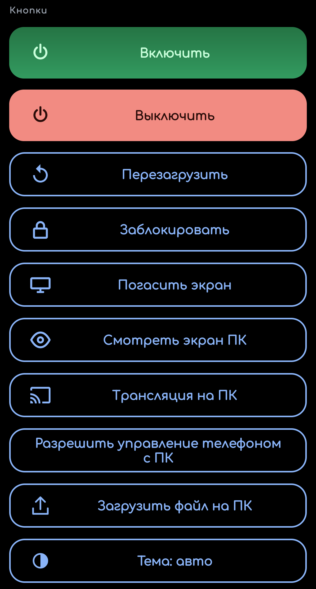

«Смотреть экран ПК» открывает изображение компьютера. «Трансляция на ПК» отправляет изображение телефона в главное окно Windows; Android попросит разрешение на захват экрана. «Загрузить файл на ПК» открывает выбор файла. На снимке показана только область кнопок.

---

# English

[Home](../README.md) · [Getting started](GETTING_STARTED.md#english)

These are real application screens on an empty profile. Captions explain what to select and what happens next. Solid bars hide local paths in two images. A disconnected screen does not demonstrate a live stream. Android permission prompts, installers and Windows UAC may look different on your device.

## Windows: connection

Start the server, then choose Android installation or the already-installed option. Before a new pairing, the app guides you through Wake-on-LAN setup.

## Install the Android app

Skip downloading if the app is already installed. The install button opens the next screen.

This QR links to the public APK on GitHub; it does not pair the phone. Download it, confirm installation on Android, then select the installed/continue button.

## Required first-time setup

Before first pairing, the app checks Wake-on-LAN settings. This shows the top of the page waiting for the check; confirmation controls are farther down. It does not demonstrate successful configuration or waking.

## Pair the phone

After setup, select your home network adapter and create a QR. This screenshot intentionally has an empty adapter list and no active pairing session. Pairing QR codes are not published: they are intended only for your phone.

## Phone screen

This is the disconnected state: no IP is entered and no live video is shown. After pairing and starting the viewer, the video appears in this same area.

## Received files

Choose a destination folder on the PC or reset it to Downloads. The local path is hidden in this public image; changes apply to future transfers.

## Applications

“Add…” selects an EXE or LNK shortcut on the PC. The program then becomes available as a button on the phone. The list is empty in this screenshot.

## Video and audio

The regular installer includes FFmpeg and ffplay. This page lets you choose a local tools folder or use automatic discovery. Restart the server and viewer to apply changes.

## Wake your PC

This page explains the Windows check and manual BIOS/UEFI settings. The screenshot shows the state before checking. 100% means the actions finished, not proof that the PC will wake.

## Android: navigation menu

The menu groups PC controls, applications, files, casting and settings. The upper-right cross closes it, and the version is at the bottom. This is Android 1.17 using the device's system font.

## Android: control your PC

“View PC screen” opens the computer display. “Cast to PC” sends the phone display to the main Windows window; Android asks for screen capture permission. “Upload file to PC” opens the file picker. Only the button area is shown here.
